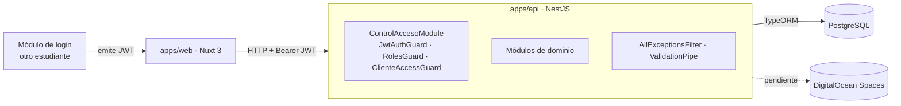
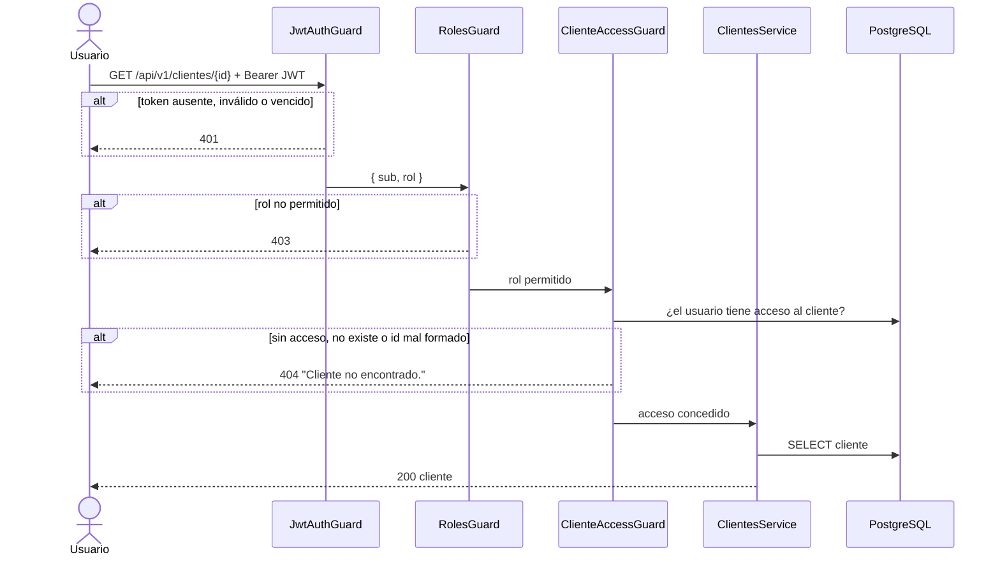

# Arquitectura del backend

Describe lo que **está construido** en `apps/api` (NestJS 11 + TypeORM sobre PostgreSQL). Complementa a `diccionario.md` (esquema) y `endpoints.md` (rutas).

## Visión general

Monorepo pnpm: `apps/api` (NestJS), `apps/web` (Nuxt 3, aún sin funcionalidad), `db/migrations` (SQL versionado), `docs`.

- Base de datos: PostgreSQL. El esquema solo cambia con migraciones SQL (`db/migrations`, 10 archivos); TypeORM únicamente mapea tablas (`synchronize: false`, `migrationsRun: false`).
- Archivos de clientes: DigitalOcean Spaces (variables `SPACES_*` definidas; la subida aún no está implementada).
- Autenticación: la API **solo valida** el JWT (HS256, secreto `JWT_SECRET`); el login y la emisión del token son de otro módulo.
- Contrato: prefijo `/api/v1`; Swagger en `/api/docs`.

## Módulos (`AppModule`)

| Módulo                       | Carpeta          | Controlador                 | Entidades TypeORM                                                                                                                                         | Rutas |
| ---------------------------- | ---------------- | --------------------------- | --------------------------------------------------------------------------------------------------------------------------------------------------------- | ----- |
| ControlAccesoModule (global) | `common/auth`    | —                           | usa `Cliente`, `ClienteAuxiliar`                                                                                                                          | —     |
| UsuariosRolesModule          | `usuarios-roles` | `usuarios-roles.controller` | Rol, TipoAsesor, Usuario                                                                                                                                  | 6     |
| ClientesModule               | `clientes`       | `clientes.controller`       | Cliente, ClienteAuxiliar, ClienteObjetivoEspecifico, HistorialLaboral, InformacionIssste, RegimenPrincipal, LeyProbable, Afore, ObjetivoEspecificoInicial | 18    |
| DocumentosModule             | `documentos`     | `documentos.controller`     | DocumentoCliente, TipoDocumento                                                                                                                           | 5     |
| EtapasModule                 | `etapas`         | `etapas.controller`         | EtapaProceso, EtapaTramite, EtapaTramiteHistorial, EstatusTramite                                                                                         | 6     |
| TramitesModule               | `tramites`       | `tramites.controller`       | CorreccionCliente, TipoCorreccion, UnificacionNssDetalle, UnificacionNssSecundario                                                                        | 9     |
| DiagnosticosModule           | `diagnosticos`   | `diagnosticos.controller`   | 25 entidades de F1 (diagnóstico, catálogos, puentes, escenarios, plan de acción, situación patrimonial…)                                                  | 27    |
| AgendaModule                 | `agenda`         | `agenda.controller`         | EventoAgenda                                                                                                                                              | 4     |
| AvisosModule                 | `avisos`         | `avisos.controller`         | Aviso                                                                                                                                                     | 3     |
| ReportesModule               | `reportes`       | `reportes.controller`       | —                                                                                                                                                         | 1     |
| EtlModule                    | `etl`            | `etl.controller`            | —                                                                                                                                                         | 1     |
| (AppModule)                  | `health`         | `health.controller`         | —                                                                                                                                                         | 1     |

Total: 49 entidades mapeadas, 81 rutas. Cada módulo sigue el patrón controlador → servicio → entidades/DTO.

Transversal en `AppModule`: `ConfigModule` global con `validarEntorno` (en producción no arranca si `JWT_SECRET` falta o es el marcador del ejemplo), `TypeOrmModule`, y `AllExceptionsFilter` (respuesta de error uniforme `{ statusCode, error, message, path, timestamp }`). En `configureApp`: prefijo global, `ValidationPipe` (`whitelist`, `forbidNonWhitelisted`, `transform`) y `ClassSerializerInterceptor` (`usuarios.contrasena_hash` nunca sale en una respuesta).

## Estado de implementación

| Capa                                                   | Estado                                             |
| ------------------------------------------------------ | -------------------------------------------------- |
| Esquema SQL, entidades, DTO, módulos, contrato Swagger | Hecho                                              |
| Control de acceso (3 guards + `dev:token` + pruebas)   | Hecho; cableado solo en `GET /clientes/:clienteId` |
| Lógica de negocio de los servicios                     | **No hecha**: 79 de 81 rutas responden 501         |
| Subida a Spaces, reportes, ETL                         | Esbozo                                             |

## Control de acceso

Permisos por rol en un solo archivo (`common/auth/permisos.ts`), consumidos con `@Roles(...)`. El `rol` del token se normaliza en un solo lugar (`normalizar-rol.ts`); el resto del código solo conoce `{ sub, rol }`.

| Guard                | Hace                                                                                                                                                          | Falla con                                                      |
| -------------------- | ------------------------------------------------------------------------------------------------------------------------------------------------------------- | -------------------------------------------------------------- |
| `JwtAuthGuard`       | Valida `Authorization: Bearer`, HS256; exige `sub` (uuid), `rol` válido y `exp`. No consulta la BD.                                                           | 401                                                            |
| `RolesGuard`         | Compara el rol con `@Roles(...)` (el del método anula al del controlador).                                                                                    | 403                                                            |
| `ClienteAccessGuard` | En rutas con `:clienteId`: asesor → `clientes.asesor_id = sub`; auxiliar → registro activo en `cliente_auxiliares`; supervisor → cualquier cliente existente. | 404 (mismo mensaje exista o no, para no revelar la existencia) |

### Secuencia de autorización de una petición a un cliente

## Casos de uso por rol (Tabla 2, según `permisos.ts`)

| Área                 | Asesor                                    | Auxiliar                        | Supervisor             |
| -------------------- | ----------------------------------------- | ------------------------------- | ---------------------- |
| Catálogos (lectura)  | ✔                                         | ✔                               | ✔                      |
| Usuarios y roles     |                                           |                                 | ✔ (leer y escribir)    |
| Clientes             | leer, crear, editar, gestionar auxiliares | listar y ver (solo autorizados) | leer, reasignar asesor |
| Documentos           | leer, subir, revisar                      | leer, subir, revisar            | leer, revisar          |
| Etapas               | leer, escribir                            |                                 | leer                   |
| Trámites F2–F4       | leer, escribir                            |                                 |                        |
| Diagnósticos F0/F1   | leer, escribir                            |                                 |                        |
| Agenda               | leer, escribir                            | leer                            | leer                   |
| Avisos               | leer, atender                             | leer, atender                   | leer, atender          |
| Reportes             | ✔                                         |                                 | ✔                      |
| ETL (importar Excel) |                                           |                                 | ✔                      |

Algunos permisos no están en la Tabla 2 y se asumieron (anotados en `permisos.ts`): `clientes.crear` solo asesor, `agenda.escribir` solo asesor, `etapas.leer` también supervisor, `etl.importar` solo supervisor, catálogos para todos.
