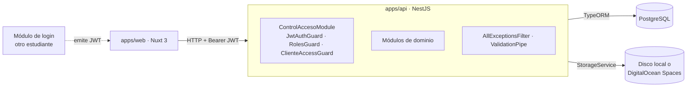
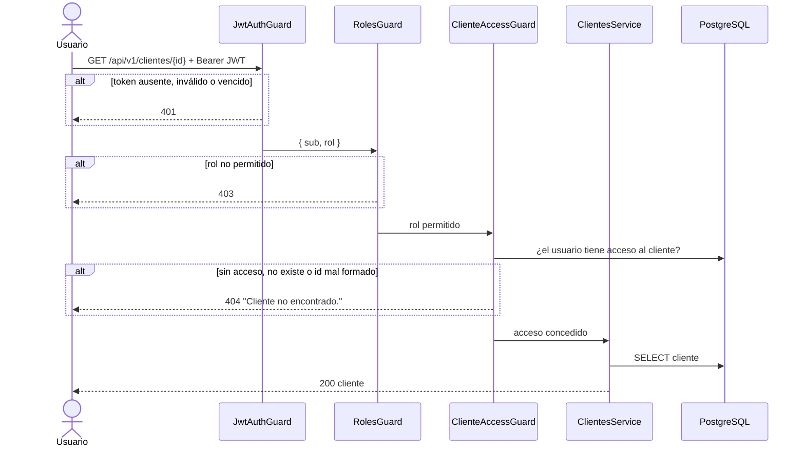

# Arquitectura del backend

Describe lo que **está construido** en `apps/api` (NestJS 11 + TypeORM sobre PostgreSQL). Complementa a `diccionario.md` (esquema) y `endpoints.md` (rutas).

## Visión general

Monorepo pnpm: `apps/api` (NestJS), `apps/web` (Nuxt 3, aún sin funcionalidad), `db/migrations` (SQL versionado), `docs`.

- Base de datos: PostgreSQL. El esquema solo cambia con migraciones SQL (`db/migrations`, 11 archivos); TypeORM únicamente mapea tablas (`synchronize: false`, `migrationsRun: false`).
- Archivos de clientes: `StorageService` intercambiable (`STORAGE_DRIVER=local|spaces`): disco local en desarrollo y DigitalOcean Spaces en producción (variables `SPACES_*`). El formato F0 se genera en PDF con pdfkit.
- Autenticación: `AuthModule` emite el JWT (HS256, secreto `JWT_SECRET`) en `POST /auth/login` y permite a cualquier usuario autenticado cambiar su propia contraseña en `PATCH /auth/contrasena` (la actual incorrecta es 400, no 401). El Supervisor restablece la de otro usuario en `PATCH /usuarios/:usuarioId/contrasena` (204, también para usuarios inactivos). En ambos casos el cifrado pasa por `PasswordHasher` y solo se escribe `usuarios.contrasena_hash`.
- Auxiliares disponibles: `GET /auxiliares` (asesor y supervisor; el auxiliar 403) lista los usuarios con rol auxiliar —`id`, nombre, apellidos, `correo_electronico` y `activo`, ordenados por nombre, sin `contrasena_hash`— para el selector «Autorizar a un auxiliar» y para mostrar el nombre de cada auxiliar autorizado.
- Contrato: prefijo `/api/v1`; Swagger UI en `/api/docs` y el JSON del contrato en `/api/docs-json` (lista las 119 rutas, con módulo y respuestas; lo comprueba `swagger.e2e.spec.ts`).

## Módulos (`AppModule`)

| Módulo                       | Carpeta          | Controlador                 | Entidades TypeORM                                                                                                                                                                                                                                                                  | Rutas |
| ---------------------------- | ---------------- | --------------------------- | ---------------------------------------------------------------------------------------------------------------------------------------------------------------------------------------------------------------------------------------------------------------------------------- | ----- |
| ControlAccesoModule (global) | `common/auth`    | —                           | usa `Cliente`, `ClienteAuxiliar`                                                                                                                                                                                                                                                   | —     |
| UsuariosRolesModule          | `usuarios-roles` | `usuarios-roles.controller` | Rol, TipoAsesor, Usuario                                                                                                                                                                                                                                                           | 7     |
| ClientesModule               | `clientes`       | `clientes.controller`       | Cliente, ClienteAuxiliar, ClienteObjetivoEspecifico, HistorialLaboral, InformacionIssste, RegimenPrincipal, LeyProbable, Afore, ObjetivoEspecificoInicial                                                                                                                          | 19    |
| DocumentosModule             | `documentos`     | `documentos.controller`     | DocumentoCliente, TipoDocumento                                                                                                                                                                                                                                                    | 6     |
| EtapasModule                 | `etapas`         | `etapas.controller`         | EtapaProceso, EtapaTramite, EtapaTramiteHistorial, EstatusTramite                                                                                                                                                                                                                  | 6     |
| TramitesModule               | `tramites`       | `tramites.controller`       | CorreccionCliente, TipoCorreccion, UnificacionNssDetalle, UnificacionNssSecundario                                                                                                                                                                                                 | 9     |
| DiagnosticosModule           | `diagnosticos`   | `diagnosticos.controller`   | 25 entidades de F1 (diagnóstico, catálogos, puentes, escenarios, plan de acción, situación patrimonial…)                                                                                                                                                                           | 27    |
| AgendaModule                 | `agenda`         | `agenda.controller`         | EventoAgenda                                                                                                                                                                                                                                                                       | 4     |
| AvisosModule                 | `avisos`         | `avisos.controller`         | Aviso                                                                                                                                                                                                                                                                              | 3     |
| DashboardModule              | `dashboard`      | `dashboard.controller`      | — (`DashboardService` calcula el resumen con consultas SQL agregadas)                                                                                                                                                                                                              | 1     |
| ReportesModule               | `reportes`       | `reportes.controller`       | — (`ReportesService` calcula el reporte operativo con SQL sobre etapas, bitácora y clientes; `ReportePdfService` imprime ese reporte; `F0PdfService` arma el formato F0 (las piezas comunes están en `pdf-base`): `f0-modelo` decide qué va en cada campo y `f0-dibujo` lo dibuja) | 2     |
| EtlModule                    | `etl`            | `etl.controller`            | `EtlService` orquesta la importación desde el Excel; `CargadorClientes` carga por lotes con una transacción por lote (usa `ClientesService.crear`); piezas puras de lectura, saneo, validación y duplicados; comando `pnpm etl:importar` (`cli.ts`)                                | 1     |
| (AppModule)                  | `health`         | `health.controller`         | —                                                                                                                                                                                                                                                                                  | 1     |

Total: 50 entidades mapeadas, 119 rutas. Cada módulo sigue el patrón controlador → servicio → entidades/DTO.

Transversal en `AppModule`: `ConfigModule` global con `validarEntorno` (en producción no arranca si `JWT_SECRET` falta o es el marcador del ejemplo), `TypeOrmModule`, y `AllExceptionsFilter` (respuesta de error uniforme `{ statusCode, error, message, path, timestamp }`). En `configureApp`: prefijo global, `ValidationPipe` (`whitelist`, `forbidNonWhitelisted`, `transform`) y `ClassSerializerInterceptor` (`usuarios.contrasena_hash` nunca sale en una respuesta).

## Estado de implementación

**117 de 119 rutas implementadas; las otras 2 responden 501.** El detalle por ruta está en `endpoints.md`; los resultados de las pruebas, en `pruebas-resultados.md` (lo genera `node scripts/reporte-pruebas.mjs`).

| Módulo         | Implementadas | Qué hay                                                                                                                                                                                                                                                                                                                                                     | Pendiente (501)                                                     |
| -------------- | ------------- | ----------------------------------------------------------------------------------------------------------------------------------------------------------------------------------------------------------------------------------------------------------------------------------------------------------------------------------------------------------- | ------------------------------------------------------------------- |
| usuarios-roles | 7 de 7        | Alta, edición y baja con contraseña cifrada (bcrypt), restablecer contraseña (Supervisor), catálogos de roles y tipos de asesor                                                                                                                                                                                                                             | —                                                                   |
| clientes       | 19 de 19      | Listado por rol, alta con sus 16 etapas, edición, reasignación, autorizaciones del auxiliar y su lista, historial laboral, información ISSSTE (leer y guardar), objetivos específicos, catálogos, PDF del F0 con el diseño del formato oficial                                                                                                              | listado de auxiliares, lecturas de historial y objetivos, catálogos |
| etapas         | 4 de 6        | Lista de las 16 etapas con avance global, cambio de estatus con bitácora atómica, historial de solo lectura (el Auxiliar lo lee en sus clientes autorizados) y catálogo de estatus                                                                                                                                                                          | Alta de etapa, catálogos de etapas y estatus                        |
| tramites       | 11 de 11      | Correcciones F2 (alta, listado, detalle y edición parcial; se aplican al expediente al finalizar la etapa 2), catálogo de tipos de corrección, unificación de NSS F3 con secundarios (alta y lecturas del detalle y de los secundarios), y `GET /correcciones` (solo asesor): clientes que requieren alguna fase F2, F3 o F4, para el módulo «Correcciones» | —                                                                   |
| diagnosticos   | 55 de 55      | F1 completo por pasos: cabecera (borrador), 11 listas que se reemplazan con PUT, recuperación de semanas, retroactivo, escenarios (máximo 3), periodos de inconsistencias, plan de acción, situación patrimonial con hijos, 8 catálogos, avance de la etapa 1 y PDF del formato F1 (409 con faltantes)                                                      | El resto del diagnóstico especializado F1                           |
| agenda         | 4 de 4        | Alta, consulta y reagendado por rol                                                                                                                                                                                                                                                                                                                         | —                                                                   |
| avisos         | 3 de 3        | Bandeja generada al consultar, sin duplicados; obtener un aviso; atender. Cada aviso trae, en la misma consulta, cliente, asesor (solo nombre), título, descripción, fecha del compromiso, hora (citas) y número de paso, avance y estatus (trámites)                                                                                                       | —                                                                   |
| dashboard      | 1 de 1        | `GET /dashboard`: resumen de Inicio ya calculado (ver «Dashboard de Inicio»)                                                                                                                                                                                                                                                                                |                                                                     |
| documentos     | 6 de 6        | Subida multipart con reemplazo, revisión, descarga, lista y detalle; almacenamiento local o Spaces                                                                                                                                                                                                                                                          | Catálogo de tipos de documento                                      |
| reportes       | 2 de 2        | Reporte operativo semanal, mensual o trimestral por periodo (etapas 0 a 4): cartera por etapa y estatus, finalizados, vencidos y por vencer, tasa de rechazo, clientes nuevos por régimen y avance por asesor (supervisor)                                                                                                                                  | Exportación en PDF                                                  |
| etl            | 1 de 1        | `POST /etl/importaciones` (solo Supervisor): importa la hoja Clientes del Excel de control operativo, con simulacro, reporte y conciliación; el mismo núcleo lo usa el comando `pnpm etl:importar` (ver «Importación desde Excel (ETL)»)                                                                                                                    | Importación desde Excel                                             |
| health         | 1 de 1        | `GET /health` (pública)                                                                                                                                                                                                                                                                                                                                     | —                                                                   |

| Capa transversal                                       | Estado                                                                                                                                                                                      |
| ------------------------------------------------------ | ------------------------------------------------------------------------------------------------------------------------------------------------------------------------------------------- |
| Esquema SQL, entidades, DTO, módulos, contrato Swagger | Hecho                                                                                                                                                                                       |
| Control de acceso (3 guards + `dev:token` + pruebas)   | Hecho y aplicado en las 119 rutas (matriz probada)                                                                                                                                          |
| Pruebas                                                | 75 suites, 717 pruebas (716 pasan y 1 se omite: el generador de evidencia, que solo corre con `ETL_EVIDENCIA=1`), 0 `it.todo`; casos CP-01 a CP-331 documentados en `pruebas-resultados.md` |

## Importación desde Excel (ETL)

Núcleo único (`EtlService.importar`) que usan `POST /etl/importaciones` (multipart, solo Supervisor, máximo 10 MB) y el comando `pnpm etl:importar` (`--archivo`, `--ejecutor`, `--simulacro`, `--lote`, `--equivalencias`, `--salida`). Flujo: lector de la hoja `Clientes` (por nombre de encabezado) → saneadores por campo → validador de renglón (acumula todos los rechazos) → duplicados (en el archivo y contra la base) → cargador por lotes (una transacción por lote; si falla, se reintenta renglón por renglón) → conciliación y reporte (`reporte.json` y `rechazados.csv`, con CURP y NSS enmascarados).

- Los clientes se crean con `ClientesService.crear` dentro de la transacción del lote y sus 16 etapas se escriben directo con el estatus, avance, acción y fecha del Excel, sin historial.
- Configuración: `ETL_EQUIVALENCIAS` (JSON nombre del asesor a correo; sin él, 503) y `ETL_SALIDA` (carpeta de reportes, una subcarpeta propia por corrida; no se versiona).
- Corrida de aceptación con el Excel ficticio: `docs/etl-corrida-ficticia/`.

## Dashboard de Inicio

`GET /dashboard` (asesor, auxiliar y supervisor) devuelve el resumen ya calculado para que el frontend no pida las etapas y los documentos de cada cliente. Alcance por rol con `aplicarAlcanceClientes` (asesor: sus clientes; auxiliar: los autorizados activos; supervisor: todos), aplicado una sola vez en la CTE `alcance`. Hoy y el mes salen del `Reloj` en America/Cancun. El parámetro `?limite` (entero de 1 a 50, 8 por omisión) limita solo las listas; los totales y conteos son completos. Se resuelve en 5 consultas agregadas (6 para el supervisor, que además recibe `asesores_activos` y `carga_por_asesor`, y 6 para el asesor, que recibe `avance_por_cliente`; para los demás roles esas claves son `null`), sin consultas por cliente ni por documento.

`avance_por_cliente` (solo asesor): una fila por cliente activo, ordenada por `cliente_nombre`, con `etapas` siempre de 16 elementos (`numero_paso` 0 a 15, `avance_porcentaje`, `estatus_id`); un cliente sin esa etapa (o sin etapas) trae avance 0 y `estatus_id` null. No la limita `?limite`: el tope es de 200 clientes y `total_avance_por_cliente` trae el total real.

Reglas de negocio (las mismas que hoy calcula el frontend):

- **Cliente activo:** su etapa 15 (Finalización) no está en estatus Finalizado (si no tiene esa etapa, es activo). Los demás son «pensionados».
- **Etapa actual:** la de menor `numero_paso` con estatus En proceso (cliente, asesor o Instituto), Bloqueado o Detenido; si no hay, la de menor paso Por iniciar; si no, la de mayor paso (la 15 cuando todo está finalizado). Cada cliente activo cuenta en una sola etapa; un cliente sin etapas cuenta en la 0. `clientes_por_etapa` siempre trae las 16 etapas y suma `clientes_activos`.
- **Avance detenido (cliente activo):** alguna etapa en estatus Detenido, o 15 días o más desde su última actividad (el máximo de `etapas_tramite.actualizado_el`, en fecha de Cancún). `dias_sin_actividad` = hoy − esa fecha.
- **Acción del mes:** etapa de un cliente activo con `fecha_compromiso` dentro del mes actual y estatus distinto de Cancelado y No aplica. Estado `completada` si la etapa está Finalizada o tiene `fecha_completada`; `vencida` si no está completada y la fecha es anterior a hoy; `proxima` en los demás casos.
- **Documentos:** solo de clientes activos. Pendientes = `por_confirmar`; con observaciones («no válidos») = `no`. `documentos_pendientes` lista ambos, por `fecha_carga` ascendente.
- De las personas (asesor y quien subió un documento) solo se entrega nombre y apellido paterno; `subido_por_nombre` es `null` si el usuario ya no existe.

## Reporte operativo: periodo trimestral y trazabilidad

- `periodo` acepta `semanal` (lunes a domingo), `mensual` (mes calendario) y `trimestral` (trimestre de calendario que contiene `fecha`: ene-mar, abr-jun, jul-sep, oct-dic; `desde` es el día 1 del primer mes y `hasta` el último día del tercero). Todas las secciones usan ese mismo rango. Un periodo inválido responde 400 con «periodo debe ser semanal, mensual o trimestral.». El PDF se titula «Reporte operativo trimestral» y se descarga como `Reporte-operativo-trimestral-<desde>.pdf`.
- `trazabilidad: { total, lista }`: cambios de estatus de las etapas 0 a 4 ocurridos dentro del rango (historial `etapas_tramite_historial`), del más reciente al más antiguo; `lista` trae como máximo 20 y `total` cuenta todos. Cada fila: `cliente`, `numero_paso`, `etapa`, `estatus_anterior` (null en el primer registro de la etapa), `estatus_nuevo`, `fecha` (AAAA-MM-DD, America/Cancun) y `asesor` (nombre y apellido paterno del asesor del cliente). Una sola consulta agregada (`COUNT(*) OVER ()` para el total), con el alcance por rol del resto del reporte. En el PDF es la sección 7 (después de «Clientes nuevos»); el avance por asesor del supervisor pasa a la 8.

## Módulo «Correcciones» (`GET /correcciones`)

Solo el asesor (auxiliar y supervisor 403). Lista únicamente los clientes del asesor que **requieren al menos una fase**, por `actualizado_el` descendente (después `cliente_nombre`), máximo 500, en una sola consulta agregada. Cada cliente trae siempre las 3 fases (`numero_paso` 2, 3 y 4) con los campos de su etapa (`etapa_tramite_id`, `estatus_id`, `estatus`, `avance_porcentaje`, `fecha_compromiso`, `accion_a_realizar`; sin la etapa: estatus `null` y avance 0) más:

- `requiere`: **F2** si el cliente tiene al menos una corrección en `correcciones_cliente` cuyo tipo no es «Unificación de NSS» (id 7); **F3** si tiene una de ese tipo; **F4** si su diagnóstico especializado (F1) tiene un análisis de recuperación de semanas con `aplica` = `si` o `requiere_mas_evidencia`.
- `correcciones`: solo en F2, cuántas correcciones tiene sin contar las de tipo NSS (`null` en F3 y F4).
- `documentos_cargados`: en F3, los documentos del tipo «Certificación de regularización y/o corrección de datos personales del asegurado (IMSS)» (id 15); en F4, los de «Constancia de Aclaración de Semanas Cotizadas (IMSS)» (16) y «Solicitud de Reintegro de Recursos (AFORE)» (17); `null` en F2. Los tipos se buscan por nombre.

`actualizado_el` es el mayor `actualizado_el` de sus etapas 2, 3 y 4; sin ellas se usa la fecha de ingreso del cliente a las 00:00 de Cancún (la tabla `clientes` no tiene fecha de creación). `resumen` es `{ clientes_con_correcciones, documentos_por_subir }`: los clientes del asesor que cumplen (todos, aunque la lista se corte en 500) y las fases F3 o F4 con `requiere = true` y `documentos_cargados = 0`.

Quitar una corrección: `DELETE /clientes/:clienteId/correcciones/:correccionId` (solo asesor dueño; 204 sin cuerpo; 404 «Corrección no encontrada.» si no existe o es de otro cliente). Si la corrección es de unificación de NSS, borra antes su detalle y sus NSS secundarios (las claves foráneas no son en cascada), todo en una transacción. No revierte el expediente: lo que ya se aplicó a `clientes` al finalizar la etapa 2 se queda. Cambia el cálculo de `GET /correcciones`: F2 deja de requerirse cuando ya no quedan correcciones que no sean de tipo NSS.

Unificación de NSS (lecturas): `GET .../unificacion-nss` devuelve el detalle (404 si la corrección no es del cliente o aún no tiene detalle) y `GET .../unificacion-nss/secundarios` la lista de NSS secundarios (`[]` si no hay detalle; 404 si la corrección no es del cliente).

## Avisos: citas reagendadas y reapertura

- **Qué genera avisos:** las etapas con compromiso (salvo Finalizado, Cancelado y No aplica) y los eventos de agenda **pendientes o reagendados** (una cita reagendada sigue siendo un compromiso por cumplir). Cumplido y cancelado no generan avisos. Aplica tanto al filtro de vigencia de `GET /avisos` como a la generación.
- **Reapertura:** los avisos tienen clave (origen, `fecha_alerta`). Si cambia `fecha_compromiso` de una etapa (`PATCH /clientes/:id/etapas/:etapaId`) o la fecha u hora de un evento (`PATCH /agenda/:id`) y ya existe un aviso de ese origen con la `fecha_alerta` de la nueva fecha y `atendido = true`, queda pendiente (`atendido = false`, `atendido_por` y `fecha_atencion` en null). Solo se toca ese aviso; los de otras fechas no cambian. Se hace en la misma transacción que el cambio de fecha (`avisos/alerta.ts`, `reabrirAvisoAtendido`).
- «Cambia» significa que el valor enviado difiere del actual (una hora «10:00» equivale a «10:00:00»); un PATCH que repite la fecha y la hora, o que solo cambia el motivo o el estatus, no reabre nada.

## Control de acceso

Permisos por rol en un solo archivo (`common/auth/permisos.ts`), consumidos con `@Roles(...)`. El `rol` del token se normaliza en un solo lugar (`normalizar-rol.ts`); el resto del código solo conoce `{ sub, rol }`.

| Guard                | Hace                                                                                                                                                          | Falla con                                                      |
| -------------------- | ------------------------------------------------------------------------------------------------------------------------------------------------------------- | -------------------------------------------------------------- |
| `JwtAuthGuard`       | Valida `Authorization: Bearer`, HS256; exige `sub` (uuid), `rol` válido y `exp`. No consulta la BD.                                                           | 401                                                            |
| `RolesGuard`         | Compara el rol con `@Roles(...)` (el del método anula al del controlador). Se niega por defecto: una ruta sin `@Roles` ni `@Publico()` responde 403.          | 403                                                            |
| `ClienteAccessGuard` | En rutas con `:clienteId`: asesor → `clientes.asesor_id = sub`; auxiliar → registro activo en `cliente_auxiliares`; supervisor → cualquier cliente existente. | 404 (mismo mensaje exista o no, para no revelar la existencia) |

`JwtAuthGuard` y `RolesGuard` son globales (`APP_GUARD`, en ese orden); las rutas públicas se marcan con `@Publico()`. `ClienteAccessGuard` se declara a nivel de controlador en los cinco con rutas `:clienteId` e ignora las rutas sin cliente.

### Secuencia de autorización de una petición a un cliente

## Diagnóstico Especializado (F1): guardado por pasos y avance de la etapa 1

El asistente del F1 guarda cada sección con su propia ruta (`/clientes/:id/diagnostico/...`); el diagnóstico es un borrador
hasta que se descarga el PDF (`GET /clientes/:id/diagnostico/pdf`, 409 con la lista de campos faltantes). Las listas con
"Otro: detalle" (objetivos, estrategias, inconsistencias, gestiones y evidencias de recuperación, objetivos y criterios de
Modalidad 10 y 40, preguntas del retroactivo, documentos requeridos e hijos) se guardan completas con un PUT que reemplaza
la lista anterior.

**Regla de avance de la etapa 1** (se recalcula tras cada guardado exitoso del F1, nunca en un GET). Hay 13 secciones
capturables (la 14, aviso de alcance y firmas, es texto fijo del PDF) y cada una cuenta como completa así:

| #   | Sección                  | Completa cuando                                                  |
| --- | ------------------------ | ---------------------------------------------------------------- |
| 1   | Objetivos                | hay al menos un objetivo                                         |
| 2   | Documentos requeridos    | al menos un documento con Sí/No contestado                       |
| 3   | Régimen pensionario      | tipo de pensión, edad objetivo y "cotizó antes de julio de 1997" |
| 4   | Semanas cotizadas        | semanas efectivas para pensión                                   |
| 5   | Conservación de derechos | tiene conservación, dentro de conservación y conviene pensionar  |
| 6   | Recuperación de semanas  | existe el análisis                                               |
| 7   | Modalidad 10             | conclusión preliminar                                            |
| 8   | Modalidad 40             | conclusión preliminar y baja del régimen obligatorio             |
| 9   | Retroactivo              | conclusión preliminar                                            |
| 10  | Escenarios               | al menos un escenario                                            |
| 11  | Situación patrimonial    | existe el registro                                               |
| 12  | Recomendación final      | justificación y al menos una estrategia                          |
| 13  | Plan de acción           | al menos una acción                                              |

Con N secciones completas (N >= 1) la etapa 1 queda En proceso asesor con avance `20 + floor(70 x N / 13)`: 25 % con una
sección y 90 % con las 13. Con N = 0 no se toca la etapa. Solo se mueve una etapa Por iniciar (pasa a En proceso asesor y
deja su fila en la bitácora, a nombre del asesor) o ya En proceso asesor (cambia solo el avance, y baja si una sección deja
de estar completa). Una etapa Finalizada, Cancelada, Bloqueada, Detenida o con otro estatus no se toca; finalizar la etapa
sigue siendo decisión del asesor en la pantalla de etapas.

## Casos de uso por rol (Tabla 2, según `permisos.ts`)

| Área                 | Asesor                                    | Auxiliar                        | Supervisor             |
| -------------------- | ----------------------------------------- | ------------------------------- | ---------------------- |
| Catálogos (lectura)  | ✔                                         | ✔                               | ✔                      |
| Usuarios y roles     |                                           |                                 | ✔ (leer y escribir)    |
| Clientes             | leer, crear, editar, gestionar auxiliares | listar y ver (solo autorizados) | leer, reasignar asesor |
| Documentos           | leer, subir, revisar                      | leer, subir, revisar            | leer, revisar          |
| Etapas               | leer, escribir                            | leer (solo autorizados)         | leer                   |
| Trámites F2–F4       | leer, escribir                            |                                 |                        |
| Diagnósticos F0/F1   | leer, escribir                            |                                 |                        |
| Agenda               | leer, escribir                            | leer                            | leer                   |
| Avisos               | leer, atender                             | leer, atender                   | leer, atender          |
| Reportes             | ✔                                         |                                 | ✔                      |
| ETL (importar Excel) |                                           |                                 | ✔                      |

Algunos permisos no están en la Tabla 2 y se asumieron (anotados en `permisos.ts`): `clientes.crear` solo asesor, `agenda.escribir` solo asesor, `etapas.leer` también supervisor y, en solo lectura y solo de sus clientes autorizados, auxiliar (D9, RF-18), `etl.importar` solo supervisor, catálogos para todos.
