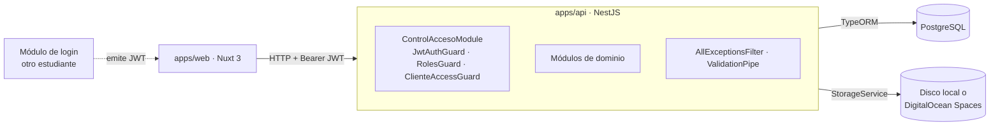
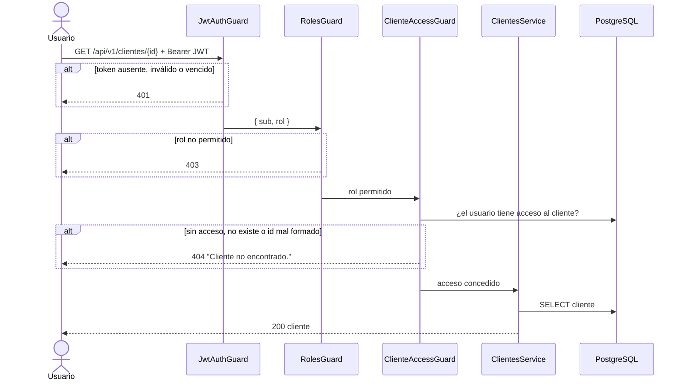

# Arquitectura del backend

Describe lo que **está construido** en `apps/api` (NestJS 11 + TypeORM sobre PostgreSQL). Complementa a `diccionario.md` (esquema) y `endpoints.md` (rutas).

## Visión general

Monorepo pnpm: `apps/api` (NestJS), `apps/web` (Nuxt 3, aún sin funcionalidad), `db/migrations` (SQL versionado), `docs`.

- Base de datos: PostgreSQL. El esquema solo cambia con migraciones SQL (`db/migrations`, 11 archivos); TypeORM únicamente mapea tablas (`synchronize: false`, `migrationsRun: false`).
- Archivos de clientes: `StorageService` intercambiable (`STORAGE_DRIVER=local|spaces`): disco local en desarrollo y DigitalOcean Spaces en producción (variables `SPACES_*`). El formato F0 se genera en PDF con pdfkit.
- Autenticación: `AuthModule` emite el JWT (HS256, secreto `JWT_SECRET`) en `POST /auth/login` y permite a cualquier usuario autenticado cambiar su propia contraseña en `PATCH /auth/contrasena` (la actual incorrecta es 400, no 401). El Supervisor restablece la de otro usuario en `PATCH /usuarios/:usuarioId/contrasena` (204, también para usuarios inactivos). En ambos casos el cifrado pasa por `PasswordHasher` y solo se escribe `usuarios.contrasena_hash`.
- Contrato: prefijo `/api/v1`; Swagger en `/api/docs`.

## Módulos (`AppModule`)

| Módulo                       | Carpeta          | Controlador                 | Entidades TypeORM                                                                                                                                                                                                                                                                  | Rutas |
| ---------------------------- | ---------------- | --------------------------- | ---------------------------------------------------------------------------------------------------------------------------------------------------------------------------------------------------------------------------------------------------------------------------------- | ----- |
| ControlAccesoModule (global) | `common/auth`    | —                           | usa `Cliente`, `ClienteAuxiliar`                                                                                                                                                                                                                                                   | —     |
| UsuariosRolesModule          | `usuarios-roles` | `usuarios-roles.controller` | Rol, TipoAsesor, Usuario                                                                                                                                                                                                                                                           | 7     |
| ClientesModule               | `clientes`       | `clientes.controller`       | Cliente, ClienteAuxiliar, ClienteObjetivoEspecifico, HistorialLaboral, InformacionIssste, RegimenPrincipal, LeyProbable, Afore, ObjetivoEspecificoInicial                                                                                                                          | 19    |
| DocumentosModule             | `documentos`     | `documentos.controller`     | DocumentoCliente, TipoDocumento                                                                                                                                                                                                                                                    | 6     |
| EtapasModule                 | `etapas`         | `etapas.controller`         | EtapaProceso, EtapaTramite, EtapaTramiteHistorial, EstatusTramite                                                                                                                                                                                                                  | 6     |
| TramitesModule               | `tramites`       | `tramites.controller`       | CorreccionCliente, TipoCorreccion, UnificacionNssDetalle, UnificacionNssSecundario                                                                                                                                                                                                 | 9     |
| DiagnosticosModule           | `diagnosticos`   | `diagnosticos.controller`   | 25 entidades de F1 (diagnóstico, catálogos, puentes, escenarios, plan de acción, situación patrimonial…)                                                                                                                                                                           | 27    |
| AgendaModule                 | `agenda`         | `agenda.controller`         | EventoAgenda                                                                                                                                                                                                                                                                       | 4     |
| AvisosModule                 | `avisos`         | `avisos.controller`         | Aviso                                                                                                                                                                                                                                                                              | 3     |
| ReportesModule               | `reportes`       | `reportes.controller`       | — (`ReportesService` calcula el reporte operativo con SQL sobre etapas, bitácora y clientes; `ReportePdfService` imprime ese reporte; `F0PdfService` arma el formato F0 (las piezas comunes están en `pdf-base`): `f0-modelo` decide qué va en cada campo y `f0-dibujo` lo dibuja) | 2     |
| EtlModule                    | `etl`            | `etl.controller`            | —                                                                                                                                                                                                                                                                                  | 1     |
| (AppModule)                  | `health`         | `health.controller`         | —                                                                                                                                                                                                                                                                                  | 1     |

Total: 49 entidades mapeadas, 84 rutas. Cada módulo sigue el patrón controlador → servicio → entidades/DTO.

Transversal en `AppModule`: `ConfigModule` global con `validarEntorno` (en producción no arranca si `JWT_SECRET` falta o es el marcador del ejemplo), `TypeOrmModule`, y `AllExceptionsFilter` (respuesta de error uniforme `{ statusCode, error, message, path, timestamp }`). En `configureApp`: prefijo global, `ValidationPipe` (`whitelist`, `forbidNonWhitelisted`, `transform`) y `ClassSerializerInterceptor` (`usuarios.contrasena_hash` nunca sale en una respuesta).

## Estado de implementación

**36 de 84 rutas implementadas; las otras 47 responden 501.** El detalle por ruta está en `endpoints.md`; los resultados de las pruebas, en `pruebas-resultados.md` (lo genera `node scripts/reporte-pruebas.mjs`).

| Módulo         | Implementadas | Qué hay                                                                                                                                                                                                                        | Pendiente (501)                                                             |
| -------------- | ------------- | ------------------------------------------------------------------------------------------------------------------------------------------------------------------------------------------------------------------------------ | --------------------------------------------------------------------------- |
| usuarios-roles | 7 de 7        | Alta, edición y baja con contraseña cifrada (bcrypt), restablecer contraseña (Supervisor), catálogos de roles y tipos de asesor                                                                                                | —                                                                           |
| clientes       | 10 de 19      | Listado por rol, alta con sus 16 etapas, edición, reasignación, autorizaciones del auxiliar, historial laboral, objetivos específicos, PDF del F0 con el diseño del formato oficial (Caladea, logo y 6 secciones en 2 páginas) | ISSSTE, listado de auxiliares, lecturas de historial y objetivos, catálogos |
| etapas         | 3 de 6        | Lista de las 16 etapas con avance global, cambio de estatus con bitácora atómica, historial de solo lectura                                                                                                                    | Alta de etapa, catálogos de etapas y estatus                                |
| tramites       | 3 de 9        | Correcciones F2 (se aplican al expediente al finalizar la etapa 2), unificación de NSS F3 con secundarios                                                                                                                      | Listados, detalle y edición de correcciones, catálogo                       |
| diagnosticos   | 1 de 27       | Dictamen de recuperación de semanas (F4) que actualiza `semanas_imss_reconocidas`                                                                                                                                              | El resto del diagnóstico especializado F1                                   |
| agenda         | 4 de 4        | Alta, consulta y reagendado por rol                                                                                                                                                                                            | —                                                                           |
| avisos         | 2 de 3        | Bandeja generada al consultar, sin duplicados; atender                                                                                                                                                                         | Obtener un aviso                                                            |
| documentos     | 5 de 6        | Subida multipart con reemplazo, revisión, descarga, lista y detalle; almacenamiento local o Spaces                                                                                                                             | Catálogo de tipos de documento                                              |
| reportes       | 2 de 2        | Reporte operativo semanal o mensual por periodo (etapas 0 a 4): cartera por etapa y estatus, finalizados, vencidos y por vencer, tasa de rechazo, clientes nuevos por régimen y avance por asesor (supervisor)                 | Exportación en PDF                                                          |
| etl            | 0 de 1        | Esbozo                                                                                                                                                                                                                         | Importación desde Excel                                                     |
| health         | 1 de 1        | `GET /health` (pública)                                                                                                                                                                                                        | —                                                                           |

| Capa transversal                                       | Estado                                                                                                         |
| ------------------------------------------------------ | -------------------------------------------------------------------------------------------------------------- |
| Esquema SQL, entidades, DTO, módulos, contrato Swagger | Hecho                                                                                                          |
| Control de acceso (3 guards + `dev:token` + pruebas)   | Hecho y aplicado en las 84 rutas (matriz probada)                                                              |
| Pruebas                                                | 38 suites, 267 pruebas (todas pasan), 0 `it.todo`; casos CP-01 a CP-68 documentados en `pruebas-resultados.md` |

## Control de acceso

Permisos por rol en un solo archivo (`common/auth/permisos.ts`), consumidos con `@Roles(...)`. El `rol` del token se normaliza en un solo lugar (`normalizar-rol.ts`); el resto del código solo conoce `{ sub, rol }`.

| Guard                | Hace                                                                                                                                                          | Falla con                                                      |
| -------------------- | ------------------------------------------------------------------------------------------------------------------------------------------------------------- | -------------------------------------------------------------- |
| `JwtAuthGuard`       | Valida `Authorization: Bearer`, HS256; exige `sub` (uuid), `rol` válido y `exp`. No consulta la BD.                                                           | 401                                                            |
| `RolesGuard`         | Compara el rol con `@Roles(...)` (el del método anula al del controlador). Se niega por defecto: una ruta sin `@Roles` ni `@Publico()` responde 403.          | 403                                                            |
| `ClienteAccessGuard` | En rutas con `:clienteId`: asesor → `clientes.asesor_id = sub`; auxiliar → registro activo en `cliente_auxiliares`; supervisor → cualquier cliente existente. | 404 (mismo mensaje exista o no, para no revelar la existencia) |

`JwtAuthGuard` y `RolesGuard` son globales (`APP_GUARD`, en ese orden); las rutas públicas se marcan con `@Publico()`. `ClienteAccessGuard` se declara a nivel de controlador en los cinco con rutas `:clienteId` e ignora las rutas sin cliente.

### Secuencia de autorización de una petición a un cliente

## Casos de uso por rol (Tabla 2, según `permisos.ts`)

| Área                 | Asesor                                    | Auxiliar                        | Supervisor             |
| -------------------- | ----------------------------------------- | ------------------------------- | ---------------------- |
| Catálogos (lectura)  | ✔                                         | ✔                               | ✔                      |
| Usuarios y roles     |                                           |                                 | ✔ (leer y escribir)    |
| Clientes             | leer, crear, editar, gestionar auxiliares | listar y ver (solo autorizados) | leer, reasignar asesor |
| Documentos           | leer, subir, revisar                      | leer, subir, revisar            | leer, revisar          |
| Etapas               | leer, escribir                            | leer (solo autorizados)         | leer                   |
| Trámites F2–F4       | leer, escribir                            |                                 |                        |
| Diagnósticos F0/F1   | leer, escribir                            |                                 |                        |
| Agenda               | leer, escribir                            | leer                            | leer                   |
| Avisos               | leer, atender                             | leer, atender                   | leer, atender          |
| Reportes             | ✔                                         |                                 | ✔                      |
| ETL (importar Excel) |                                           |                                 | ✔                      |

Algunos permisos no están en la Tabla 2 y se asumieron (anotados en `permisos.ts`): `clientes.crear` solo asesor, `agenda.escribir` solo asesor, `etapas.leer` también supervisor y, en solo lectura y solo de sus clientes autorizados, auxiliar (D9, RF-18), `etl.importar` solo supervisor, catálogos para todos.
